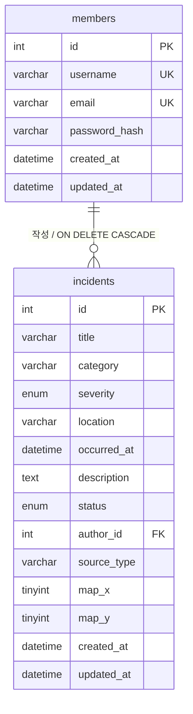

# 데이터베이스 설계

실행 기준은 `sql/schema.sql`입니다. DB 이름은 **gotham_20612**, 앱 사용자 이름은 **20612**입니다. 관리자 준비는 `sql/admin-bootstrap.sql`, 초기 시연 데이터는 `server/scripts/seed.js`를 사용합니다.

## 관계



회원 한 명은 여러 사건을 작성하고 사건 한 건은 회원 한 명을 참조합니다. 회원 탈퇴 시 해당 작성 사건도 삭제되는 정책입니다.

## members

| 컬럼 | 제약·역할 |
|---|---|
| id | PK, AUTO_INCREMENT, 회원 번호 |
| username | NOT NULL, UNIQUE, 로그인 회원의 아이디 |
| email | NOT NULL, UNIQUE, 로그인에 사용하는 이메일 |
| password_hash | NOT NULL, bcrypt 해시, API 미노출 |
| created_at | 생성 시각 |
| updated_at | 수정 시각 |

서버에서 입력을 검증하고 DB UNIQUE 제약으로 동시 가입의 중복도 막습니다. 기존 프론트 필드 `member_id`, `nickname`은 각각 `id`, `username`의 응답 별칭입니다. `nickname`이 별도의 비유일 표시 이름을 뜻하지 않습니다.

## incidents

| 컬럼 | 제약·역할 |
|---|---|
| id | PK, AUTO_INCREMENT, 사건 고유 번호 |
| title | NOT NULL, 사건명 |
| category | 사건 유형, API 별칭 event_type |
| severity | 낮음·보통·높음·긴급 |
| location | 발생 위치, API 별칭 sector |
| occurred_at | 발생 시각 |
| description | 사건 설명 |
| status | 접수·검토 중·처리 완료 |
| author_id | NOT NULL, FK → members.id |
| source_type | 훈련 상황보고·가상 기상센서 등 정보 출처 |
| map_x, map_y | 가상 지도 0~100 정수 좌표, CHECK 제약 |
| created_at, updated_at | 생성·수정 시각 |

작성자 인덱스는 외래 키와 작성자 조회를 지원합니다. 발생 시각·ID 인덱스는 최신순 목록, 상태 인덱스는 상태 조회를 지원합니다. 실제 자료형·길이·인덱스 이름은 실행 SQL에서 확인합니다.

## 삭제·권한 정책

```sql
FOREIGN KEY (author_id) REFERENCES members(id)
ON DELETE CASCADE
```

회원 탈퇴의 `DELETE FROM members WHERE id = ?`가 작성 사건도 삭제합니다. 부모 행을 삭제할 때 DB가 자식 행을 처리하므로 화면에서 사건을 하나씩 삭제하지 않아도 됩니다. 확인 모달은 작성 사건도 삭제됨을 알립니다.

사건 수정·삭제는 인증 미들웨어와 작성자 비교를 거친 뒤 SQL에도 `WHERE id = ? AND author_id = ?`를 적용합니다. 프론트에서 버튼을 숨기는 것은 편의 기능이며 권한 보장은 서버가 담당합니다.

## 시간·인코딩

- 문자셋은 utf8mb4이며 한글·유니코드를 저장합니다.
- 서버의 MySQL 연결은 UTC 기준을 사용합니다. DATETIME은 시간대 정보를 자체 보관하지 않으므로 UTC 값을 저장한다는 규칙을 일관되게 적용합니다.
- API는 `2026-11-08T05:20:00.000Z`처럼 ISO 8601을 반환하고, 프론트는 `2026-11-08 14:20 KST`로 표시합니다.
- Workbench에서 한국 시각으로 비교하려면 `CONVERT_TZ(occurred_at, '+00:00', '+09:00')`를 사용할 수 있습니다.

## Workbench 확인

```sql
USE gotham_20612;
SHOW TABLES;
SHOW CREATE TABLE members;
SHOW CREATE TABLE incidents;

SELECT id, username, email, created_at, updated_at FROM members;
SELECT id, title, category, severity, location, occurred_at,
       description, status, author_id, created_at, updated_at
FROM incidents ORDER BY id DESC;

SELECT i.id, i.title, i.category, i.severity, i.status,
       m.username, m.email, i.created_at
FROM incidents AS i
INNER JOIN members AS m ON i.author_id = m.id
ORDER BY i.occurred_at DESC, i.id DESC;
```

스키마의 `IF NOT EXISTS`는 기존 테이블 구조를 바꾸지 않습니다. 다른 프로젝트의 과거 테이블이 존재한다면 백업 후 별도의 마이그레이션을 계획해야 합니다. 이전 스키마 초안은 보관용 `.sql.txt`이며 현재 스키마에 실행하지 않습니다.

## 분석 전용 테이블: analysis_records

외부 API·GeoJSON·CSV에서 가져온 분석 데이터는 세 번째 테이블 `analysis_records`에 저장합니다. 원본 식별자·출처 이름·URL·가져온 시각과 실제 좌표·지진 규모를 보존합니다. members와 FK로 연결하지 않으므로 일반 회원의 사건이나 작성자를 위조하지 않습니다. 회원 탈퇴의 CASCADE 대상도 아닙니다. 사용자 웹 CRUD·필수 INNER JOIN은 기존 두 테이블에서 수행하며 이 테이블은 서버 가져오기와 공개 읽기 전용 조회에 사용합니다. 세부 필드는 `sql/schema.sql`과 `DATA_SOURCES.md`가 기준입니다.
